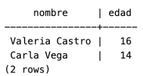
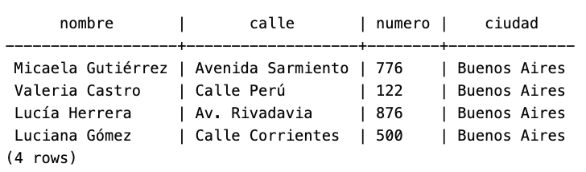
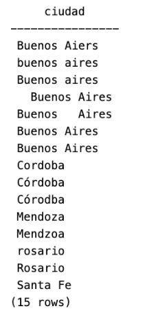
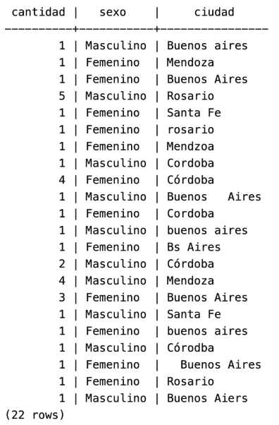
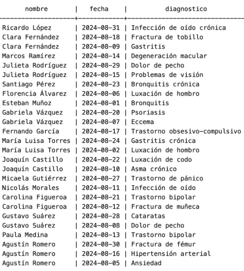
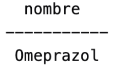
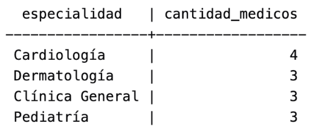
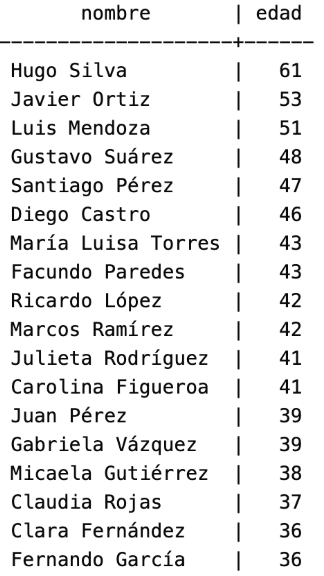
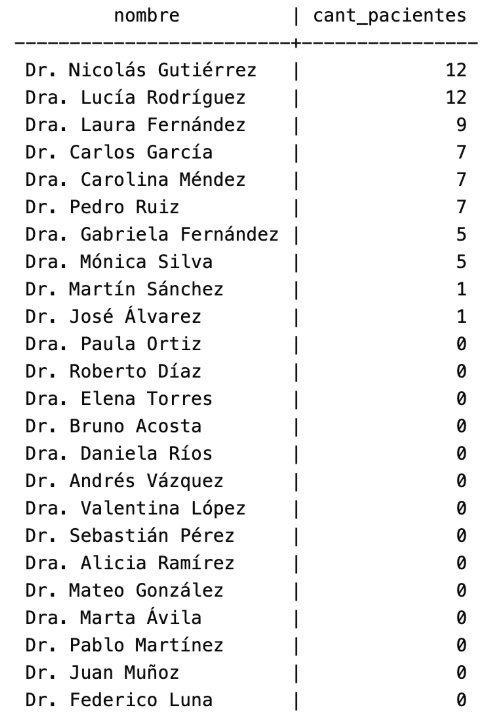
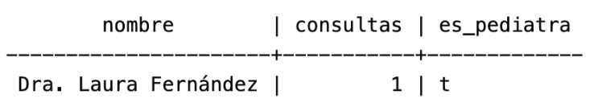

<p align="center">
  
</p>

## **TP 4: Bases de Datos**

---

### **Grupo 6**
- **69496** — Mariana Antunes Ferreira (`mantunesferreira@itba.edu.ar`)
- **63517** — Melanie Natasha Mauas (`memauas@itba.edu.ar`)
- **63068** — Luciana Renieri (`lrenieri@itba.edu.ar`)

---
### Parte 1: Bases de Datos

## Parte 1: Bases de Datos

### **1. ¿Qué tipo de base de datos es? Clasificarla según su propósito.**
Base de Datos Relacional Transaccional.  
Su objetivo principal es la operación diaria de la institución médica (registro de pacientes, emisión de recetas, consultas). Está diseñada para procesar múltiples transacciones rápidas y concurrentes (como lecturas, altas y actualizaciones de datos de pacientes/consultas), garantizando consistencia, integridad de los datos y cumplimiento de las propiedades ACID.

### **2. Planteando el Modelo conceptual, armar el diagrama entidad-relación de la base de datos dada.**
*(Usar notación de Chen, marcando tipo de participación, cardinalidad, claves primarias y parciales).*

<p align="center">
  
</p>

### **3. Mapear del Modelo conceptual planteado en el punto 2 al Modelo Relacional de la base de datos dada.**
*(Usar notación Crow’s foot en el diagrama, indicando cardinalidad mínima y máxima).*

<p align="center">
  
</p>

### **4. Indicar qué forma normal se viola en los siguientes casos y justificar:**

1. **Se viola la Primera Forma Normal (1FN):**  
   La 1FN exige que todos los atributos contengan valores atómicos (mínimos e indivisibles) y que no existan listas, arreglos ni grupos repetidos en una sola celda. En este caso, la celda del registro 1 para la columna *Teléfonos* almacena múltiples valores (`1111`, `2222`), lo cual rompe la atomicidad.

2. **Se viola la Tercera Forma Normal (3FN):**  
   La 3FN exige que no existan dependencias transitivas entre atributos que no forman parte de la clave primaria. En este caso, `CódigoPostal` determina a la `Ciudad` (o viceversa), por lo que existe un atributo no clave dependiente de otro atributo no clave.

3. **Se viola la Segunda Forma Normal (2FN):**  
   La 2FN requiere que la tabla esté en 1FN y que todos los atributos no clave dependan totalmente de la clave primaria completa, sin existencias de dependencias parciales. En esta tabla con clave primaria compuesta (`PacienteID`, `MédicoID`):
   - `Nombre Paciente` depende únicamente de `PacienteID`.
   - `Especialidad` depende únicamente de `MédicoID`.  
   Al depender de solo una parte de la clave compuesta, se viola la 2FN.

4. **Se viola la Cuarta Forma Normal (4FN):**  
   La 4FN establece que no deben existir dependencias multivaluadas entre atributos independientes entre sí. Aquí existen dos dependencias multivaluadas independientes para el mismo paciente: `PacienteID -> Enfermedad` y `PacienteID -> Medicamento`. Intentar combinar ambas listas en una sola tabla genera redundancia de datos.

---

## Parte 2: SQL

### **Consigna 1**

```sql
CREATE INDEX idx_pacientes_ciudad  
ON Pacientes (ciudad);
```

### **Consigna 2**
```sql
SELECT  
   nombre,  
   fecha_nacimiento,  
   EXTRACT(YEAR FROM AGE(CURRENT_DATE, fecha_nacimiento)) AS edad  
FROM Pacientes;

CREATE VIEW vista_pacientes_edad AS  
SELECT  
   id_paciente,  
   nombre,  
   fecha_nacimiento,  
   id_sexo,  
   numero,  
   calle,  
   ciudad,  
   EXTRACT(YEAR FROM AGE(CURRENT_DATE, fecha_nacimiento))::INT AS edad  
FROM Pacientes;
```
<p align="center">
  
</p>

### **Consigna 3** 

```sql
SELECT nombre, edad  
FROM vista_pacientes_edad  
WHERE edad < 18;

SELECT  
   nombre,  
   EXTRACT(YEAR FROM AGE(CURRENT_DATE, fecha_nacimiento))::INT AS edad  
FROM Pacientes  
WHERE EXTRACT(YEAR FROM AGE(CURRENT_DATE, fecha_nacimiento)) < 18;
```
<p align="center">
  
</p>

### **Consigna 4** 

```sql
UPDATE Pacientes  
SET  
   calle = 'Calle Corrientes',  
   numero = '500',  
   ciudad = 'Buenos Aires'  
WHERE nombre = 'Luciana Gómez'  
  AND calle = 'Avenida Las Heras'  
  AND numero = '121';

SELECT nombre, calle, numero, ciudad  
FROM Pacientes  
WHERE nombre = 'Luciana Gómez';
```
<p align="center">
  
</p>

### **Consigna 5**  

```sql
SELECT nombre, calle, numero, ciudad  
FROM Pacientes  
WHERE ciudad = 'Buenos Aires';
```
<p align="center">
  
</p>

### **Consigna 6**  

```sql
SELECT DISTINCT ciudad  
FROM Pacientes  
ORDER BY ciudad;
```
<p align="center">
  
</p>

```sql
-- Normalizar variaciones de Buenos Aires ('Bs Aires', 'buenos aires', 'Buenos Aires', 'Buenos Aiers')  
UPDATE Pacientes  
SET ciudad = 'Buenos Aires'  
WHERE ciudad ILIKE '%buenos%'  
   OR ciudad ILIKE '%bs%aires%'  
   OR ciudad ILIKE '%aiers%';

-- Normalizar variaciones de Córdoba ('Cordoba', 'Córodba', 'Córdoba')  
UPDATE Pacientes  
SET ciudad = 'Córdoba'  
WHERE ciudad ILIKE '%cord%'  
   OR ciudad ILIKE '%córodba%';

-- Normalizar variaciones de Mendoza ('Mendzoa', 'Mendoza')  
UPDATE Pacientes  
SET ciudad = 'Mendoza'  
WHERE ciudad ILIKE '%mend%';

-- Normalizar minúsculas de Rosario ('rosario', 'Rosario')  
UPDATE Pacientes  
SET ciudad = 'Rosario'  
WHERE ciudad ILIKE 'rosario';

-- Normalizar minúsculas de Santa Fe  
UPDATE Pacientes  
SET ciudad = 'Santa Fe'  
WHERE ciudad ILIKE 'santa fe';

SELECT DISTINCT ciudad  
FROM Pacientes  
ORDER BY ciudad;  
```
<p align="center">
  
</p>

### **Consigna 7**

```sql
SELECT COUNT(*) AS cantidad, descripcion AS sexo, ciudad 
FROM Pacientes p  
INNER JOIN SexoBiologico s ON p.id_sexo = s.id_sexo  
GROUP BY (descripcion, ciudad);
```
<p align="center">
  
</p>

### **Consigna 8**

```sql
SELECT * FROM Consultas  
WHERE id_medico = 3  
  AND fecha >= '2024-08-01'  
  AND fecha < '2024-09-01';
```
<p align="center">
  
</p>

### **Consigna 9**
```sql
SELECT m.nombre, COUNT(r.id_receta) AS cantidad_De_Recetas_Emitidas  
FROM Medicos m  
LEFT JOIN Recetas r ON m.id_medico = r.id_medico  
GROUP BY m.id_medico, m.nombre;
```
<p align="center">
  
</p>

### **Consigna 10**

```sql
SELECT nombre, fecha, diagnostico 
FROM Consultas c  
INNER JOIN Pacientes p ON c.id_paciente = p.id_paciente  
WHERE fecha >= '2024-08-01'  
  AND fecha < '2024-09-01';
```
<p align="center">
  
</p>
Sigue tiene 33 filas.  

### **Consigna 11**

```sql
SELECT nombre FROM Medicamentos 
WHERE id_medicamento IN (  
    SELECT id_medicamento FROM Recetas  
    WHERE id_medico = 2  
    GROUP BY id_medicamento  
    HAVING COUNT(*) > 1
); 
```
<p align="center">
  
</p>

### **Consigna 12**

```sql
SELECT p.nombre, COUNT(r.id_receta) AS cant_recetas  
FROM Pacientes p  
LEFT JOIN Recetas r ON p.id_paciente = r.id_paciente  
GROUP BY p.id_paciente, p.nombre;
```
<p align="center">
  
</p> 

### **Consigna 13**

```sql
SELECT e.nombre AS especialidad,  
       COUNT(m.id_medico) AS cantidad_medicos  
FROM Especialidades e  
JOIN Medicos m ON m.especialidad_id = e.id_especialidad  
GROUP BY e.id_especialidad, e.nombre  
HAVING COUNT(m.id_medico) > 2  
ORDER BY cantidad_medicos DESC;
```
<p align="center">
  
</p>

### **Consigna 14**

```sql
SELECT nombre,  
       DATE_PART('year', AGE(fecha_nacimiento)) AS edad  
FROM Pacientes  
WHERE DATE_PART('year', AGE(fecha_nacimiento)) > (  
    SELECT AVG(DATE_PART('year', AGE(fecha_nacimiento)))  
    FROM Pacientes  
)  
ORDER BY edad DESC;
```
<p align="center">
  
</p> 

### **Consigna 15**

```sql
SSELECT medicamento, cantidad_recetas  
FROM (  
    SELECT m.nombre AS medicamento,  
           COUNT(r.id_receta) AS cantidad_recetas,  
           DENSE_RANK() OVER (ORDER BY COUNT(r.id_receta) DESC) AS posicion  
    FROM Medicamentos m  
    JOIN Recetas r ON r.id_medicamento = m.id_medicamento  
    GROUP BY m.id_medicamento, m.nombre  
) t  
WHERE posicion <= 2  
ORDER BY cantidad_recetas DESC, medicamento;
```
<p align="center">
  
</p> 

### **Consigna 16**

```sql
SELECT *  
FROM (  
    SELECT DISTINCT ON (p.id_paciente)  
           p.nombre,  
           c.fecha AS fecha_ultima_consulta,  
           c.diagnostico  
    FROM Pacientes p  
    JOIN Consultas c ON c.id_paciente = p.id_paciente  
    ORDER BY p.id_paciente, c.fecha DESC  
) t  
ORDER BY nombre;
```
<p align="center">
  
</p>

16.02 
```sql
-- Opción alternativa:
SELECT p.nombre,  
       c.fecha AS fecha_ultima_consulta,  
       c.diagnostico  
FROM Pacientes p  
JOIN Consultas c ON c.id_paciente = p.id_paciente  
WHERE c.fecha = (  
    SELECT MAX(c2.fecha)  
    FROM Consultas c2  
    WHERE c2.id_paciente = p.id_paciente  
)  
ORDER BY p.nombre;
```

### **Consigna 17**

```sql
SELECT m.nombre AS medico,  
       p.nombre AS paciente,  
       COUNT(c.id_consulta) AS total_consultas  
FROM Consultas c  
JOIN Medicos m ON m.id_medico = c.id_medico  
JOIN Pacientes p ON p.id_paciente = c.id_paciente  
GROUP BY m.id_medico, m.nombre, p.id_paciente, p.nombre  
ORDER BY m.nombre, p.nombre;
```
<p align="center">
  
</p> 

### **Consigna 18**

```sql
SELECT med.nombre AS medicamento,  
       t.total_recetas,  
       m.nombre AS medico,  
       p.nombre AS paciente  
FROM Recetas r  
JOIN Medicamentos med ON med.id_medicamento = r.id_medicamento  
JOIN Medicos m ON m.id_medico = r.id_medico  
JOIN Pacientes p ON p.id_paciente = r.id_paciente  
JOIN (  
    SELECT id_medicamento, COUNT(*) AS total_recetas  
    FROM Recetas  
    GROUP BY id_medicamento  
) t ON t.id_medicamento = r.id_medicamento  
ORDER BY t.total_recetas DESC, med.nombre, m.nombre, p.nombre;
```
<p align="center">
  
</p>


### **Consigna 19**

```sql
SELECT m.nombre, COUNT(DISTINCT c.id_paciente) AS cant_pacientes  
FROM Medicos m  
LEFT JOIN Consultas c ON c.id_medico = m.id_medico  
GROUP BY m.id_medico, m.nombre  
ORDER BY cant_pacientes DESC;
```
<p align="center">
  
</p>


### **Consigna 20**

```sql
SELECT m.nombre, COUNT(*) AS consultas, (m.especialidad_id = 1) AS es_pediatra  
FROM Medicos m  
INNER JOIN Consultas c ON m.id_medico = c.id_medico  
INNER JOIN Pacientes p ON c.id_paciente = p.id_paciente  
WHERE AGE(CURRENT_DATE, p.fecha_nacimiento) < INTERVAL '18 years'  
GROUP BY m.id_medico, m.nombre;
```
<p align="center">
  
</p> 

```sql
SELECT  
   m.nombre,  
   COUNT(p.id_paciente) AS consultas,  
   CASE  
       WHEN e.nombre = 'Pediatría' THEN TRUE  
       ELSE FALSE  
   END AS es_pediatra  
FROM Medicos m  
LEFT JOIN Especialidades e ON m.especialidad_id = e.id_especialidad  
LEFT JOIN Consultas c ON m.id_medico = c.id_medico  
LEFT JOIN Pacientes p ON c.id_paciente = p.id_paciente  
   AND AGE(CURRENT_DATE, p.fecha_nacimiento) < INTERVAL '18 years'  
GROUP BY m.id_medico, m.nombre, e.nombre  
ORDER BY consultas DESC; 
```
<p align="center">
  
</p>

### Parte 3 : Manejo de versiones con Git y Github

Link al Repo : [https\://github.com/memauas/TP4-Informatica-Medica-Grupo6](https://github.com/memauas/TP4-Informatica-Medica-Grupo6)  
