

  

**16.22 Informática Médica | 2C2026**

***TP 4 : Bases de Datos***

---

**Grupo 6**

69496		Mariana Antunes Ferreira       mantunesferreira@itba.edu.ar   
63517		Melanie Natasha Mauas	memauas@itba.edu.ar    
63068		Luciana Renieri		lrenieri@itba.edu.ar   
---

### Parte 1: Bases de Datos

**1\. ¿Qué tipo de base de datos es? Clasificarla según su propósito.**  
Base de Datos Relacional Transaccional.  
Su objetivo principal es la operación diaria de la institución médica (registro de pacientes, emisión de recetas, consultas). Está diseñada para procesar múltiples transacciones rápidas y concurrentes (como lecturas, altas y actualizaciones de datos de pacientes/consultas), garantizando consistencia, integridad de los datos y cumplimiento de las propiedades ACID.  
**2\. Planteando el Modelo conceptual, armar el diagrama entidad-relación de la base de**  
**datos dada. (Usar notación de Chen, marcando tipo de participación, cardinalidad,**  
**claves primarias y parciales).**  

  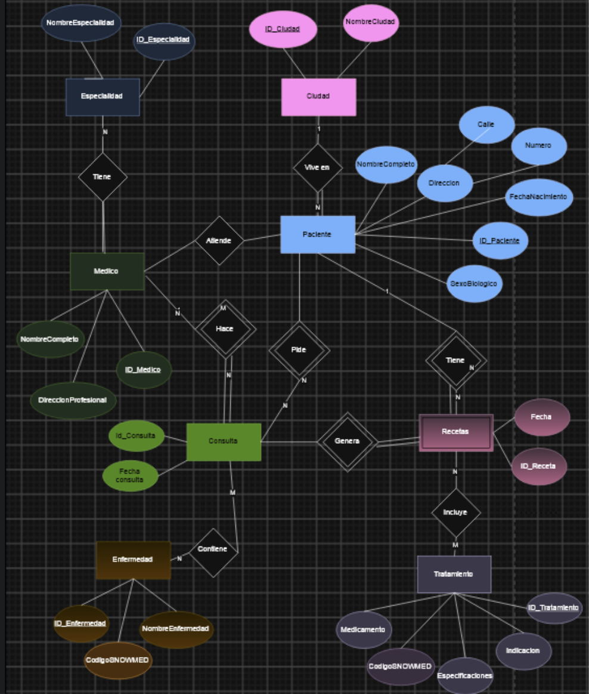

**3\. Mapear del Modelo conceptual planteado en el punto 2 al Modelo Relacional de la**  
**base de datos dada. (Usar notación Crow’s foot en el diagrama, indicando**  
**cardinalidad mínima y máxima)**.  

  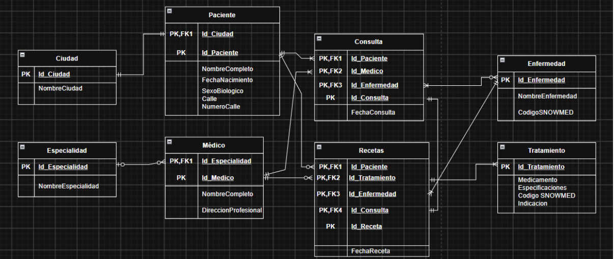

**4\. Indicar qué forma normal se viola en los siguientes casos y justificar:**  
1. Se viola la primera forma normal (1FN).   
La 1FN exige que todos los atributos contengan valores atómicos (mínimos e indivisibles) y que no existan listas, arreglos ni grupos repetidos en una sola celda. En este caso, la celda del registro 1 para la columna Teléfonos almacena múltiples valores (1111, 2222), lo cual rompe la atomicidad.  

2. Se viola la tercera forma normal (3FN).  
La 3FN exige que no existan dependencias transitivas entre atributos que no forman parte de la clave primaria. En este caso, CódigoPostal determina a la Ciudad (o viceversa), por lo que existe un atributo no clave dependiente de otro atributo no clave.  
  
3.Viola la segunda forma normal (2FN).  
La 2FN requiere que la tabla esté en 1FN y que todos los atributos no clave dependan totalmente de la clave primaria completa, sin existencias de dependencias parciales. En esta tabla con clave primaria compuesta (PacienteID, MédicoID):   Nombre Paciente depende únicamente de PacienteID.  Especialidad depende únicamente de MédicoID.   Al depender de solo una parte de la clave compuesta, se viola la 2FN.  

4.Se viola la cuarta forma normal (4FN).  
La 4FN establece que no deben existir dependencias multivaluadas entre atributos independientes entre sí. Aquí existen dos dependencias multivaluadas independientes para el mismo paciente: PacienteID \- Enfermedad y PacienteID \- Medicamento. El intentar combinar ambas listas en una sola tabla genera redundancia de datos.

### Parte 2 : SQL

\--1  
CREATE INDEX idx\_pacientes\_ciudad  
ON Pacientes (ciudad);  
\-- 2  
SELECT  
   nombre,  
   fecha\_nacimiento,  
   EXTRACT(YEAR FROM AGE(CURRENT\_DATE, fecha\_nacimiento)) AS edad  
FROM Pacientes;

CREATE VIEW vista\_pacientes\_edad AS  
SELECT  
   id\_paciente,  
   nombre,  
   fecha\_nacimiento,  
   id\_sexo,  
   numero,  
   calle,  
   ciudad,  
   EXTRACT(YEAR FROM AGE(CURRENT\_DATE, fecha\_nacimiento))::INT AS edad  
FROM Pacientes;

  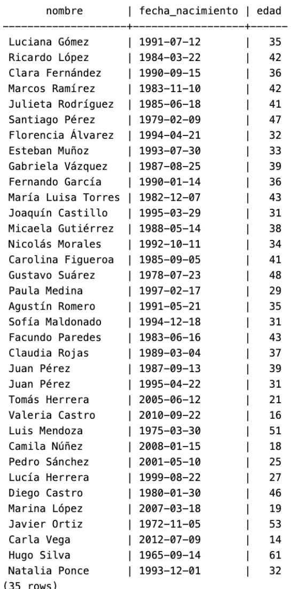

\--3  
SELECT nombre, edad  
FROM vista\_pacientes\_edad  
WHERE edad \< 18;

SELECT  
   nombre,  
   EXTRACT(YEAR FROM AGE(CURRENT\_DATE, fecha\_nacimiento))::INT AS edad  
FROM Pacientes  
WHERE EXTRACT(YEAR FROM AGE(CURRENT\_DATE, fecha\_nacimiento)) \< 18;

  

\--4  
UPDATE Pacientes  
SET  
   calle \= 'Calle Corrientes',  
   numero \= '500',  
   ciudad \= 'Buenos Aires'  
WHERE nombre \= 'Luciana Gómez'  
 AND calle \= 'Avenida Las Heras'  
 AND numero \= '121';

SELECT nombre, calle, numero, ciudad  
FROM Pacientes  
WHERE nombre \= 'Luciana Gómez';  

  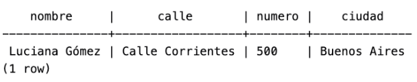

\--5  
SELECT nombre, calle, numero, ciudad  
FROM Pacientes  
WHERE ciudad \= 'Buenos Aires';  

  

\--6  
SELECT DISTINCT ciudad  
FROM Pacientes  
ORDER BY ciudad;  

  

\-- Normalizar variaciones de Buenos Aires ('Bs Aires', 'buenos aires', 'Buenos   Aires', 'Buenos Aiers')  
UPDATE Pacientes  
SET ciudad \= 'Buenos Aires'  
WHERE ciudad ILIKE '%buenos%'  
  OR ciudad ILIKE '%bs%aires%'  
  OR ciudad ILIKE '%aiers%';

\-- Normalizar variaciones de Córdoba ('Cordoba', 'Córodba', 'Córdoba')  
UPDATE Pacientes  
SET ciudad \= 'Córdoba'  
WHERE ciudad ILIKE '%cord%'  
  OR ciudad ILIKE '%córodba%';

\-- Normalizar variaciones de Mendoza ('Mendzoa', 'Mendoza')  
UPDATE Pacientes  
SET ciudad \= 'Mendoza'  
WHERE ciudad ILIKE '%mend%';

\-- Normalizar minúsculas de Rosario ('rosario', 'Rosario')  
UPDATE Pacientes  
SET ciudad \= 'Rosario'  
WHERE ciudad ILIKE 'rosario';

\-- Normalizar minúsculas de Santa Fe  
UPDATE Pacientes  
SET ciudad \= 'Santa Fe'  
WHERE ciudad ILIKE 'santa fe';

SELECT DISTINCT ciudad  
FROM Pacientes  
ORDER BY ciudad;  

  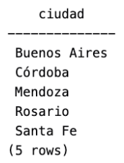

7\. SELECT COUNT(\*) as cantidad, descripcion as sexo, ciudad FROM Pacientes p  
INNER JOIN SexoBiologico s ON p.id\_sexo=s.id\_sexo  
GROUP BY (descripcion,ciudad);  

  

8\. SELECT \* FROM Consultas  
WHERE id\_medico \= 3  
AND fecha \>='2024-08-01'  
AND fecha\<'2024-09-01';  

  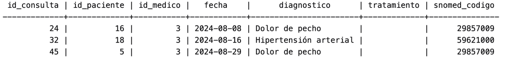

9\. SELECT m.nombre, COUNT(r.id\_receta) AS cantidad\_De\_Recetas\_Emitidas  
FROM Medicos m  
LEFT JOIN Recetas r ON m.id\_medico \= r.id\_medico  
GROUP BY m.id\_medico, m.nombre;

  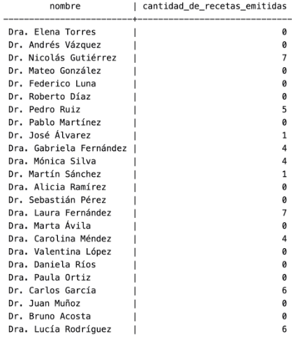

10\. SELECT nombre, fecha, diagnostico FROM Consultas c  
Inner Join Pacientes p ON c.id\_paciente \= p.id\_paciente  
WHERE fecha \>='2024-08-01'  
AND fecha\<'2024-09-01';  

  

Sigue tiene 33 filas.  
11\. SELECT nombre FROM Medicamentos WHERE id\_medicamento IN (  
SELECT id\_medicamento FROM Recetas  
WHERE id\_medico \= 2  
GROUP BY id\_medicamento  
HAVING COUNT(\*) \> 1);  

  

12\. SELECT p.nombre, COUNT(r.id\_receta) AS cant\_recetas  
FROM Pacientes p  
LEFT JOIN Recetas r ON p.id\_paciente \= r.id\_paciente  
GROUP BY p.id\_paciente, p.nombre;

  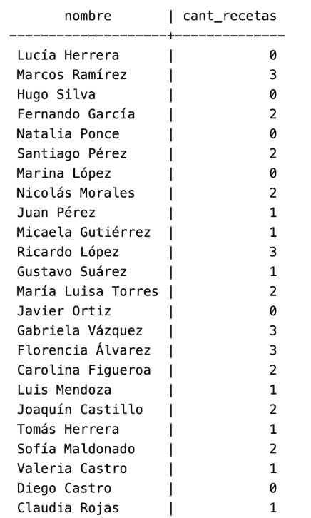

 
13\. SELECT e.nombre AS especialidad,  
       COUNT(m.id\_medico) AS cantidad\_medicos  
FROM Especialidades e  
JOIN Medicos m ON m.especialidad\_id \= e.id\_especialidad  
GROUP BY e.id\_especialidad, e.nombre  
HAVING COUNT(m.id\_medico) \> 2  
ORDER BY cantidad\_medicos DESC;  

  

14\. SELECT nombre,  
       DATE\_PART('year', AGE(fecha\_nacimiento)) AS edad  
FROM Pacientes  
WHERE DATE\_PART('year', AGE(fecha\_nacimiento)) \> (  
    SELECT AVG(DATE\_PART('year', AGE(fecha\_nacimiento)))  
    FROM Pacientes  
)  
ORDER BY edad DESC;  

  

 
15\. SELECT medicamento, cantidad\_recetas  
FROM (  
    SELECT m.nombre AS medicamento,  
           COUNT(r.id\_receta) AS cantidad\_recetas,  
           DENSE\_RANK() OVER (ORDER BY COUNT(r.id\_receta) DESC) AS posicion  
    FROM Medicamentos m  
    JOIN Recetas r ON r.id\_medicamento \= m.id\_medicamento  
    GROUP BY m.id\_medicamento, m.nombre  
) t  
WHERE posicion \<= 2  
ORDER BY cantidad\_recetas DESC, medicamento;

  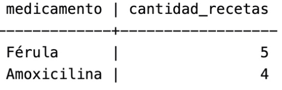

 
16\. SELECT \*  
FROM (  
    SELECT DISTINCT ON (p.id\_paciente)  
           p.nombre,  
           c.fecha AS fecha\_ultima\_consulta,  
           c.diagnostico  
    FROM Pacientes p  
    JOIN Consultas c ON c.id\_paciente \= p.id\_paciente  
    ORDER BY p.id\_paciente, c.fecha DESC  
) t  
ORDER BY nombre;

  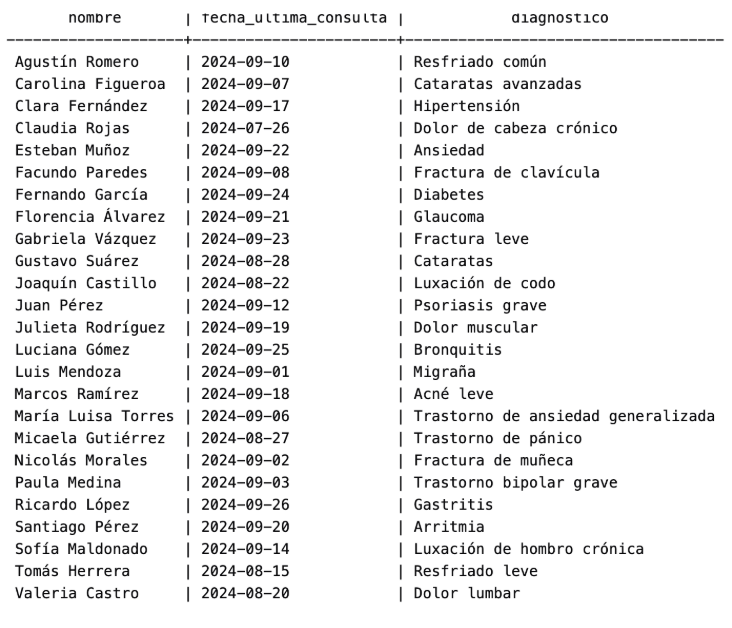

16.02 SELECT p.nombre,  
       c.fecha AS fecha\_ultima\_consulta,  
       c.diagnostico  
FROM Pacientes p  
JOIN Consultas c ON c.id\_paciente \= p.id\_paciente  
WHERE c.fecha \= (  
    SELECT MAX(c2.fecha)  
    FROM Consultas c2  
    WHERE c2.id\_paciente \= p.id\_paciente  
)  
ORDER BY p.nombre;

17\. SELECT m.nombre AS medico,  
       p.nombre AS paciente,  
       COUNT(c.id\_consulta) AS total\_consultas  
FROM Consultas c  
JOIN Medicos m ON m.id\_medico \= c.id\_medico  
JOIN Pacientes p ON p.id\_paciente \= c.id\_paciente  
GROUP BY m.id\_medico, m.nombre, p.id\_paciente, p.nombre  
ORDER BY m.nombre, p.nombre;  

  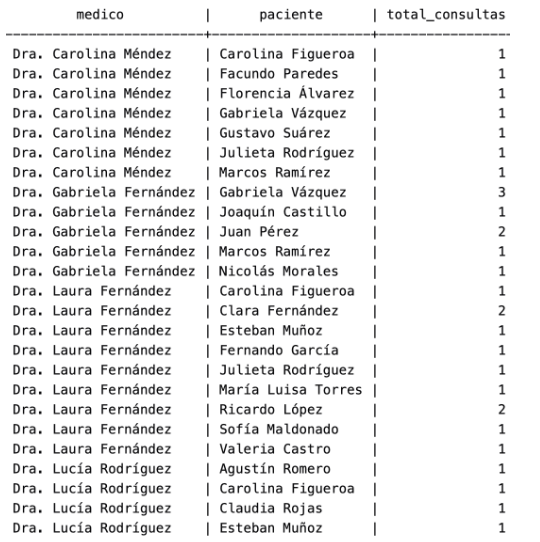

 
18\. SELECT med.nombre AS medicamento,  
       t.total\_recetas,  
       m.nombre AS medico,  
       p.nombre AS paciente  
FROM Recetas r  
JOIN Medicamentos med ON med.id\_medicamento \= r.id\_medicamento  
JOIN Medicos m ON m.id\_medico \= r.id\_medico  
JOIN Pacientes p ON p.id\_paciente \= r.id\_paciente  
JOIN (  
    SELECT id\_medicamento, COUNT(\*) AS total\_recetas  
    FROM Recetas  
    GROUP BY id\_medicamento  
) t ON t.id\_medicamento \= r.id\_medicamento  
ORDER BY t.total\_recetas DESC, med.nombre, m.nombre, p.nombre;

  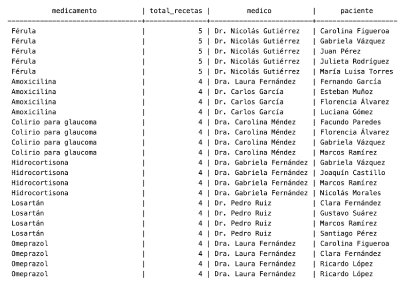

19\. SELECT m.nombre, COUNT(DISTINCT c.id\_paciente) AS cant\_pacientes  
FROM Medicos m  
LEFT JOIN Consultas c ON c.id\_medico \= m.id\_medico  
GROUP BY m.id\_medico, m.nombre  
ORDER BY cant\_pacientes DESC;

  

20\.   
SELECT m.nombre, COUNT(\*) AS consultas, (m.especialidad\_id \= 1) AS es\_pediatra  
FROM Medicos m  
INNER JOIN Consultas c ON m.id\_medico \= c.id\_medico  
INNER JOIN Pacientes p ON c.id\_paciente \= p.id\_paciente  
WHERE AGE(CURRENT\_DATE, p.fecha\_nacimiento) \< INTERVAL '18 years'  
GROUP BY m.id\_medico, m.nombre;  

  

 
SELECT  
   m.nombre,  
   COUNT(p.id\_paciente) AS consultas,  
   CASE  
       WHEN e.nombre \= 'Pediatría' THEN TRUE  
       ELSE FALSE  
   END AS es\_pediatra  
FROM Medicos m  
LEFT JOIN Especialidades e ON m.especialidad\_id \= e.id\_especialidad  
LEFT JOIN Consultas c ON m.id\_medico \= c.id\_medico  
LEFT JOIN Pacientes p ON c.id\_paciente \= p.id\_paciente  
   AND AGE(CURRENT\_DATE, p.fecha\_nacimiento) \< INTERVAL '18 years'  
GROUP BY m.id\_medico, m.nombre, e.nombre  
ORDER BY consultas DESC;  

  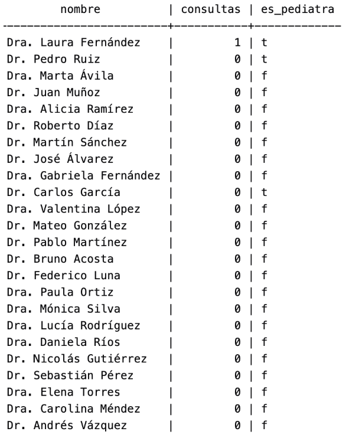

### Parte 3 : Manejo de versiones con Git y Github

Link al Repo : [https\://github.com/memauas/TP4-Informatica-Medica-Grupo6](https://github.com/memauas/TP4-Informatica-Medica-Grupo6)  
